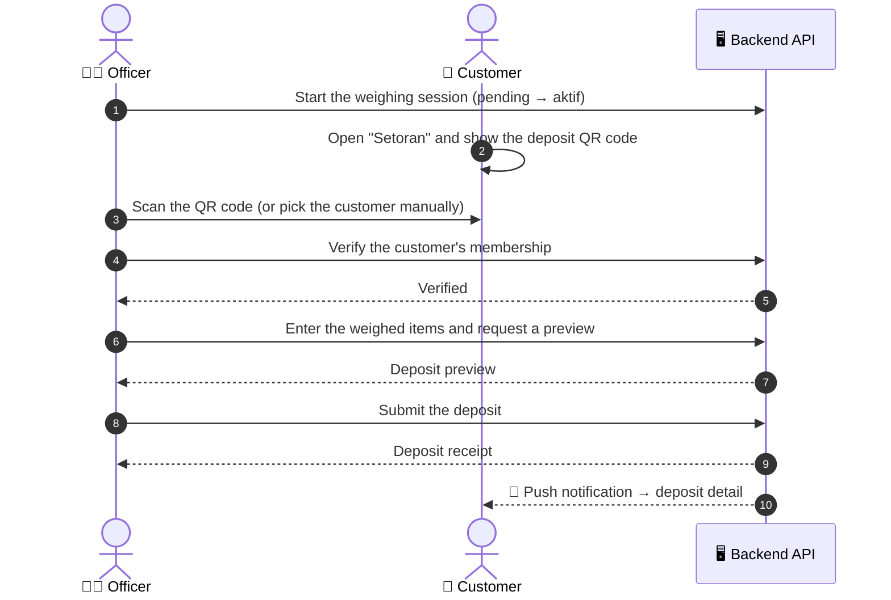
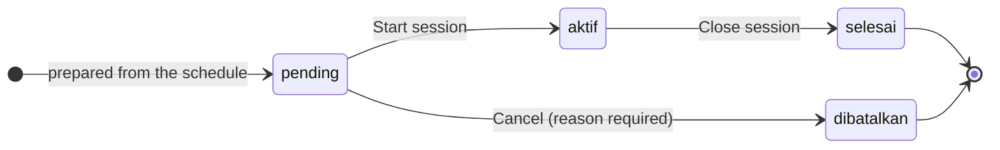

# ♻️ Enviroo Mobile

**The digital waste bank in your pocket — for customers who save their waste and the officers who weigh it.**

---

## 📱 About

Enviroo Mobile is the Flutter client of a digital waste bank platform. It talks to the Enviroo backend through a REST API and brings the daily work of a waste bank to two kinds of users:

| Actor | Who they are | What they use the app for |
| --- | --- | --- |
| 👤 **Nasabah** (customer) | A registered member of a waste bank | Showing a deposit QR code at weighing sessions, tracking their waste savings and balance mutations, browsing the catalogs |
| 🧑‍💼 **Petugas BSM** (officer) | Staff of a *Bank Sampah Mandiri* (independent waste bank) | Running weighing sessions, recording customers' deposits, browsing the catalogs |

> [!NOTE]
> The app also contains other modules: waste sales, revenue sharing, and withdrawals, as well as the BSI/BSU modules (waste transport and goods distribution). They are outside the focus of this README.

---

## 🔄 Core Business Process: Weighing → Deposit

*Customers bring their waste to a scheduled weighing session. The officer weighs it and records it as a deposit (**setoran**) into the customer's waste savings.*

1. **The officer opens a session.** Deposits can only be recorded during an active weighing session (see *Officer Features: Weighing Session Management* below).
2. **The customer shows their QR code.** While a session is active, the customer opens the *Setoran* menu and displays their **deposit QR code**, which identifies both the customer and the current session.
3. **The officer scans it** with the in-app scanner, which ignores any QR code that is not an Enviroo deposit code. If scanning is not possible, the officer can **pick the customer manually** from the bank's list of active customers, searchable by name, ID, or account number.
4. **The backend verifies the customer's membership.** If verification fails, the officer sees the reason and returns to the scanner.
5. **The officer enters the weighed quantities** for each item in the bank's waste catalog, with search and a filter by reward type.
6. **Preview, then submit.** The backend calculates a preview of the deposit before anything is saved. After submitting, the officer lands on the deposit receipt.
7. **The customer is notified.** A push notification arrives, and tapping it opens the deposit detail. Customers can also browse their full **deposit history**, filtered by month range and searchable by officer name or date.

---

## 🗂️ Waste & Goods Catalog

*Available to both customers and officers, as two tabs on the same screen.*

<table>
  <tr>
    <td width="50%" valign="top">
      <h3>♻️ Waste Catalog</h3>
      Every waste item the bank accepts, searchable and filterable by reward type: <b>All</b>, <b>Cash</b> (Rp), or <b>Points</b>. Each item opens a detail sheet with its <b>current prices</b> (the customer price and the collector price) and its <b>price change history</b>.
    </td>
    <td width="50%" valign="top">
      <h3>🎁 Goods Catalog</h3>
      Goods that customers can get by withdrawing their <b>point balance</b>. The list is searchable, and each item opens a detail view with its point price and information.
    </td>
  </tr>
</table>

---

## 👤 Customer Features

### 📒 Waste Savings Book (*Buku Tabungan Sampah*)

*A passbook of every kilogram the customer has deposited.*

- Savings are **grouped by waste type**, so customers can see how much of each type they have deposited.
- Two tabs separate the records by settlement status:
  - **Cair**: already settled, fully or partially (*Cair Sebagian*), into the customer's balance.
  - **Belum Cair**: still waiting to be settled.
- Records can be filtered by **month range**.

### 💳 Balance & Mutation Monitoring

*Customers always know what they have and where it came from.*

- The home screen shows two balance cards: **Rupiah balance** and **Points balance**.
- The **balance mutation** list (*Mutasi Saldo*) can be switched between **Rupiah** and **Points**, and filtered by **month range**.
- A summary shows the **total credit** (money in) and **total debit** (money out) for the selected period, followed by each mutation entry.

---

## 🧑‍💼 Officer Features: Weighing Session Management

*Officers control the lifecycle of every weighing session.*

- **Sessions are prepared automatically** by the backend from the bank's schedule, and appear as `pending`.
- **Manage Sessions** (*Kelola Sesi*) lists today's sessions with two guard rails:
  - **Only one session can be active at a time.** While a session is active, the others are locked.
  - **Pending sessions start in order.** Only the earliest pending session can be started or cancelled.
- **Start** a session (`pending` → `aktif`), or **cancel** it with a mandatory reason (`dibatalkan`).
- The **active session screen** shows incoming deposits (*Setoran Masuk*) as they are recorded, the shortcut to the deposit scanner, and the button to **close** the session (`aktif` → `selesai`).
- **Session history** lists completed and cancelled sessions:
  - It can be filtered by month range, with a summary of total, completed, and cancelled sessions.
  - Each session opens into its own summary (total customers and total transactions) and the list of deposits recorded in it.

---

## 🧰 Tech Stack

| Area | Packages |
| --- | --- |
| Framework | Flutter · Dart `^3.9` |
| State management | `provider` |
| Networking | `http` |
| QR code | `mobile_scanner` (scan) · `qr_flutter` (generate) |
| Push notifications | `firebase_core` · `firebase_messaging` · `flutter_local_notifications` |
| Local session storage | `shared_preferences` |
| Formatting | `intl` · `timeago` |

---

  ♻️ Every kilogram counts, and now it fits in your pocket. 🌱

